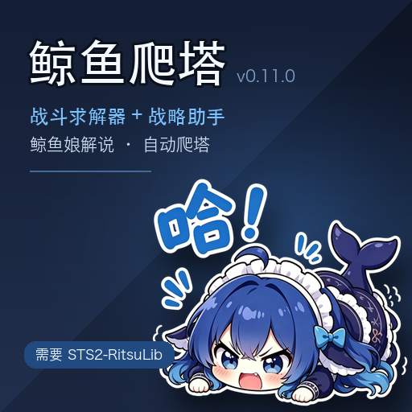

# 鲸鱼爬塔 · Sts2Whale

> 《杀戮尖塔 2》的全自动 AI 助手：**战斗求解器 + 全局战略助手 + 会说话的鲸鱼娘**（LLM 解说 + VTube Studio 皮套）。
> 编译成单个 `Sts2Whale.dll` 跑在游戏进程内，同时通过 `127.0.0.1:47821` 暴露一套语义化 HTTP。



支持 **Windows / macOS**。订阅后开局即接管，不需要碰键鼠。

---

## 它做什么

| 部分 | 管什么 |
|---|---|
| **战斗路线求解器** | 战斗内：实时枚举世界线，挑期望战损最低的出牌顺序并执行 |
| **全局战略助手** | 局外：地图选路、选牌、商店、营火、事件，全部自动决策 |
| **鲸鱼娘** | 把每个决定翻译成一句话播报（字幕条 + 语音），口吻由角色卡控制 |
| **皮套联动**（可选） | 连 VTube Studio：说话对口型、挨打分档表情、格挡举锅盖、被打歪 |
| **直播弹幕**（可选） | 读直播间弹幕，挑提问和关键词回一句，默认最多 3 条/分钟 |
| **连胜面板** | 右上角设置按钮下面：每个职业一行「当前连胜 / 最高连胜」，读存档统计 |

战斗交给求解器、局外交给战略助手、两边都不认识的情况交给鲸鱼兜底 —— 鲸鱼还负责"解说"，
所以玩家看到的是**一个角色在边打边聊**，而不是一堆自动点击。

## 安装

### 创意工坊（推荐）

1. 在创意工坊订阅 **[Sts2Whale](https://steamcommunity.com/sharedfiles/filedetails/?id=3831445513)**
2. 订阅依赖 **[STS2-RitsuLib](https://steamcommunity.com/sharedfiles/filedetails/?id=3747602295)** —— 没它 mod 不会加载
3. 启动游戏

### 本地安装

先构建出分发包（`./package.sh`，产物在 `_archive/releases/sts2-whale-mod-v<版本>.zip`），解压后：

```bash
./install.sh
# 游戏不在默认路径时：GAME_MODS="/你的/mods" ./install.sh
```

装到 `…/Slay the Spire 2/…/mods/Sts2Whale/`，`install.sh` 会保留你已有的配置文件。

## 首次启动会发生什么

- 在用户数据目录生成配置（macOS `~/Library/Application Support/SlayTheSpire2/Sts2Whale`，
  Windows `%APPDATA%\SlayTheSpire2\Sts2Whale`）—— **工坊更新不会覆盖你的配置**
- 找 Python、建独立 venv 装 `edge-tts`（**只影响语音**，约 20 秒，装完直接出声）
- **不会自己开浏览器** —— 弹幕需要你在设置页点一次「打开弹幕页」

## 依赖

| 依赖 | 必需性 | 缺失时 |
|---|---|---|
| 《杀戮尖塔 2》≥ 0.111.0 | 必需 | —— |
| **STS2-RitsuLib** | **必需** | mod 不加载 |
| Python 3.8+（含 `edge-tts`） | 语音 | 只有字幕，没声音（首次启动会自动装） |
| DeepSeek API key | 可选 | 只有本地垫话，不调模型 |
| VTube Studio | 可选 | 无皮套联动，语音照常 |
| Chrome 或 Edge | 弹幕 | 无弹幕（Windows 自带 Edge 即可） |

缺任何可选依赖都只是**对应功能降级**，不会让 mod 起不来。详见 [TECH.md](readme/TECH.md#7-依赖)。

## 设置

游戏内：**设置 → Mod 设置 → 鲸鱼爬塔**

| 段 | 内容 |
|---|---|
| 鲸鱼娘的嘴 | 模型、端点、API key、调用间隔 |
| 角色卡 | 直接编辑 `persona.md`（决定"怎么说话"的唯一来源），保存即生效 |
| 皮套 | VTS 地址、表情映射、待机摆头 |
| 直播弹幕 | 房间号、弹幕页链接、打开浏览器、限流 |

配置最终都落在用户数据目录的 json 里（`llm.json` / `vts.json` / `live.json` / `persona.md`），
手改也认，游戏内改和手改等价。

常用快捷键：**F8** 显示/隐藏战略助手面板（可在设置里改键）。

## 从源码构建

依赖 **.NET SDK 9**、游戏目录里的 `sts2.dll` / `0Harmony.dll` / `GodotSharp.dll`、
以及工坊里的 RitsuLib 参考程序集。

```bash
# macOS
./package.sh              # 构建 + 打包
./package.sh --install    # 再装进 <游戏>/mods/Sts2Whale
./release.sh              # 生成创意工坊上传包 + VDF
```

```powershell
# Windows（没有 bash，直接调 dotnet）
dotnet build Sts2Whale.csproj -c Release `
  -p:Sts2Dir="<游戏根目录>" `
  -p:Sts2DataDir="<游戏根目录>\data_sts2_windows_x86_64" `
  -p:RitsuWorkshopRoot="<工坊>\3747602295" `
  -p:OutputPath="$env:TEMP\sts2whale-build\bin\Release\" `
  -p:BaseIntermediateOutputPath="$env:TEMP\sts2whale-build\obj\"
```

> 更新已安装的 dll 必须**先删再拷**（新 inode）。原地覆盖被游戏 mmap 的文件会报 `BadImageFormatException`。

## 项目结构

```
src/merged/     本项目胶水：入口、设置页、策略桥、自动收尾、LLM 嘴、环境引导
src/bridge/     HTTP 桥、气泡 UI、弹幕（CDP）
src/whale/      皮套与语音：VTS 客户端、口型、TTS
src/solver/     CombatSolver（vendored，MIT）
src/strategist/ SpireStrategist（vendored，MIT）
tools/          tts_daemon.py（常驻语音服务）
```

## 文档

| 文档 | 内容 |
|---|---|
| [BUSINESS.md](readme/BUSINESS.md) | 产品视角：玩家看到什么、边界、成本、验收标准 |
| [TECH.md](readme/TECH.md) | 技术视角：架构、线程模型、接口表、自愈机制、依赖、踩坑 |
| [AVATAR.md](readme/AVATAR.md) | 皮套联动：表情映射、受击倾斜、语音、调试 |

## 第三方代码

本仓库直接内嵌两个上游项目的源码，它们**不是本项目原创**：

| 目录 | 上游 | 许可 | 快照 |
|---|---|---|---|
| `src/solver/` | [Torch1230/CombatSolver](https://github.com/Torch1230/CombatSolver) | MIT · `LICENSE-CombatSolver-MIT.txt` | `main` @ `5c773ca` |
| `src/strategist/` | [shaokangqian4-art/SpireStrategist](https://github.com/shaokangqian4-art/SpireStrategist) | MIT · `LICENSE-SpireStrategist-MIT.txt` | v0.6.22 |

每个目录下的 `VENDORED.md` 写明了快照版本与本地改动；本项目自身同样以 MIT 发布。
**Live2D 皮套模型不在仓库里，也不随分发包提供**（授权原因）。

## 已知限制

- 主要验证角色是**铁甲战士**；另外三个角色用的是上游策略库，未充分实测
- 它是个 AI，**会犯错**：偶尔算错伤害、选错牌 —— 建议另开存档或只在你不在意的局里用
- 建筑师（最终 Boss）战斗不归 mod 管，见到即视为本局结束
- 语音口型：macOS 按真实音频包络，Windows 按字数估（有声音，但不完全对齐）

## 许可

本项目 MIT（见 [LICENSE](LICENSE)）；两段 vendored 代码各自 MIT，版权归原作者：
[LICENSE-CombatSolver-MIT.txt](LICENSE-CombatSolver-MIT.txt)、[LICENSE-SpireStrategist-MIT.txt](LICENSE-SpireStrategist-MIT.txt)。
